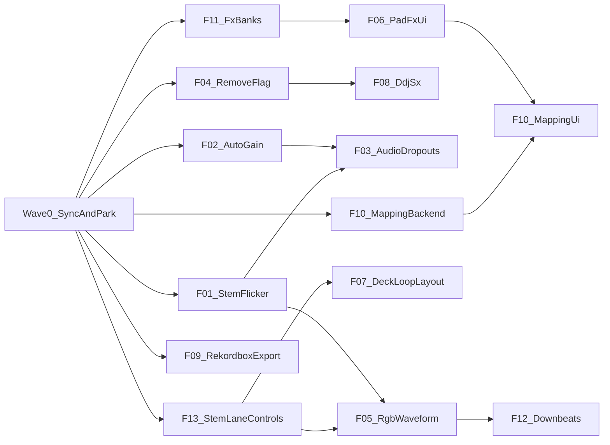

# Fixes.md - Master Orchestration Plan

## Read this first: the checkout is stale

Three things I found change how the work has to start.

- **Local `main` is not GitHub's `main`.** The last fetch was 2026-11-18 18:26. Since then PRs #53-#58 merged, including Pad FX (#57), the analysis engine (#54) and a stem waveform stability fix (#55). Local `main` carries 23 unsquashed commits that #53 already consolidated.
- **There are 34 uncommitted files (+1911/-227) plus untracked files in the main checkout.** They include library source/controller-navigation work, a rewrite of `res/qml/Deck/Loop.qml`, and edits to `CMakeLists.txt`, `src/library/librarycontrol.cpp` and `docs/agent-context.md`. Three of the fixes touch those same files.
- **Some items are partly done already.** #55 says it stops a paused stem deck from blinking, so F01 starts with a re-test. The QML UI is already the only UI, so F04 is removing a leftover flag and the gate behind it. "rbexport" is [chrisle/rbxport](https://github.com/chrisle/rbxport) (Rust); none of its export code was ever in this repo.

## Per-fix plans

Each fix is tracked as an issue on the [project board](https://github.com/users/christianstuart/projects/2); claim one by assigning yourself.

- [F01-stem-flicker.md](F01-stem-flicker.md) ([#59](https://github.com/christianstuart/paramix/issues/59)) - stem waveform flicker when paused
- [F02-auto-gain.md](F02-auto-gain.md) ([#60](https://github.com/christianstuart/paramix/issues/60)) - auto-gain not applied, clipping
- [F03-audio-dropouts.md](F03-audio-dropouts.md) ([#61](https://github.com/christianstuart/paramix/issues/61)) - audio pausing under CPU load
- [F04-remove-new-ui-flag.md](F04-remove-new-ui-flag.md) ([#62](https://github.com/christianstuart/paramix/issues/62)) - remove `--new-ui`
- [F05-rgb-waveform.md](F05-rgb-waveform.md) ([#63](https://github.com/christianstuart/paramix/issues/63)) - frequency colors on non-stem waveform and overview
- [F06-padfx-ui.md](F06-padfx-ui.md) ([#64](https://github.com/christianstuart/paramix/issues/64)) - Pad FX UI
- [F07-deck-loop-layout.md](F07-deck-loop-layout.md) ([#65](https://github.com/christianstuart/paramix/issues/65)) - loop card and deck panes
- [F08-ddj-sx.md](F08-ddj-sx.md) ([#66](https://github.com/christianstuart/paramix/issues/66)) - DDJ-SX load buttons and backspin
- [F09-rekordbox-export.md](F09-rekordbox-export.md) ([#67](https://github.com/christianstuart/paramix/issues/67)) - Rekordbox export
- [F10-midi-mapping-ui.md](F10-midi-mapping-ui.md) ([#68](https://github.com/christianstuart/paramix/issues/68)) - MIDI mapping UI
- [F11-fx-banks.md](F11-fx-banks.md) ([#69](https://github.com/christianstuart/paramix/issues/69)) - FX banks 1-2 fixed, 3-4 in a window
- [F12-downbeats.md](F12-downbeats.md) ([#70](https://github.com/christianstuart/paramix/issues/70)) - downbeat lines
- [F13-stem-lane-controls.md](F13-stem-lane-controls.md) ([#71](https://github.com/christianstuart/paramix/issues/71)) - stem labels, mute/solo, volume; remove stem pane
- [F14-padfx-modes.md](F14-padfx-modes.md) - Pad FX stuck / "Off but plays" pads; per-pad momentary or toggle
- [F15-compact-deck-band.md](F15-compact-deck-band.md) - deck transport band at loop-card height (112 -> 55 px)

Each file lists its branch, worktree, owned files, findings, steps, verification and done condition. Line numbers quoted from research came from the stale tree; agents re-locate them after wave 0.

## Wave 0 - integrator only, nothing else starts until it is done

1. **Park the uncommitted work.** In `C:\Users\Bradl\paramix`: `git switch -c bradley/wip-library-sources`, commit the 34 modified files and the untracked sources. Leave out `onnxruntime*.dll` and `docs/plans/`.
2. **Sync.** `git fetch origin`. Confirm the 23 local-only commits are fully contained in #53 (diff `ec579ed` against `b1152e5`; only #42-#44 content should differ). Then move local `main` to `origin/main`.
3. **Decide the parked work with the owner.** Default: rebase it on `main` and land it as its own PR before wave 1, because it touches `librarycontrol.cpp` (F04), `Loop.qml` (F07), `CMakeLists.txt` (F02, F09, F10) and library/sidebar files (F09). If it is not ready, F04 leaves `librarycontrol.cpp` out and F07 waits.
4. **Land the plans.** Branch `bradley/fixes-plans`, docs-only PR with `docs/plans/fixes-2026-11/` plus a copy of this master as `00-master.md`.
5. **Build synced `main`** in the main checkout and run `QmlStartupSmokeTest` and the bounds test as the baseline.
6. **Check the QML-only shortcut:** `build\paramix.exe --resource-path <worktree>\res` loads that worktree's QML. If it does not, QML lanes need their own build directories.
7. **Create the worktrees** from `origin/main` (list below). Remove or ignore the 13 old `paramix-parity-*` / `paramix-waveform-*` worktrees; their branches are merged or closed.

## Lanes

One agent per lane. Work inside a lane is serial and reuses one worktree; lanes run in parallel.

- **Integrator** - main checkout. Wave 0, merge order, `CMakeLists.txt` conflicts, `docs/agent-context.md`, owner sign-offs.
- **Waveform** - `C:\Users\Bradl\paramix-fx-waveform`. F01, then F05, then F12. C++ build.
- **Engine** - `C:\Users\Bradl\paramix-fx-engine`. F02, then F03. C++ build.
- **Deck UI** - `C:\Users\Bradl\paramix-fx-deck-ui`. F13, then F07. QML, plus one test file.
- **FX UI** - `C:\Users\Bradl\paramix-fx-effects-ui`. F11, then F06. QML only.
- **Shell** - `C:\Users\Bradl\paramix-fx-shell`. F04, then F08. C++ build for F04 only.
- **Export** - `C:\Users\Bradl\paramix-fx-rekordbox`. F09, four stacked PRs. C++ build.
- **Mapping** - `C:\Users\Bradl\paramix-fx-mapping`. F10, two stacked PRs. C++ build.

Five lanes need a full build (20-40 minutes each the first time). Disk is fine (556 GB free); stagger the first builds rather than starting five at once.

## Order

- **Wave 1 (parallel):** F01, F02, F04, F11, F13 start; F09 and F10 backend start and keep running. F08 has no shared files and can start any time.
- **Wave 2:** F03, F05, F07, F06.
- **Wave 3:** F12, the F10 UI PR, the F09 UI PR.

Merge order to `main` within wave 1: F04, F08, F01, F02, F13, F11. F04 goes first because it is the widest sweep of small edits.

## Why this order: the shared files

- **`res/qml/WaveformDisplay.qml`** - F13 (strip block), then F05 (signal renderer blocks), then F12 (beat renderer block). F01 stays in C++ and does not touch it.
- **`res/qml/Deck.qml`, `Deck/DeckPaneTabs.qml`, `Deck/HotcueAndStem.qml`** - F13 removes the stem pane and changes nothing else; F07 then redoes the layout.
- **`res/qml/MainWindow.qml` toolbar and View menu** - F11, then F06, then the F10 entry point.
- **`src/test/qml/qmlstartupsmoketest.cpp`** - F04 (parameter name), then F13, then F07 (bounds assertions).
- **`src/waveform/stemdetail/stemdetailcache.cpp`** - F01, then F03.
- **`CMakeLists.txt`** - F02, F03, F09, F10, F12 each add source or test entries. Agents add only their own lines; the integrator resolves conflicts at merge. Nobody reformats or reorders the file.
- **`res/qml/Theme/Theme.qml`** - additive only, each fix in its own labeled block (F05 colors, F07 deck metrics, F11 effects metrics).
- **`docs/agent-context.md`** - integrator only. Each agent writes `docs/plans/fixes-2026-11/worklog/Fxx.md`; the integrator folds those into the work log.

## Branching and PR rules

- Branch from `origin/main` after wave 0. Names are in each plan (`bradley/fix-<topic>`), per `docs/parallel-work.md`.
- One PR per fix; F09 and F10 are stacked PRs. Squash merge with `gh pr merge --squash --auto`. Never push to `main`.
- An agent edits only the files its plan lists. Anything else goes to the integrator as a request.
- Rebase on `main` before asking for merge, and again if a PR ahead of it in the order lands first. Second-in-lane work branches only after the first PR has merged, not from the unmerged branch.
- CI is the throughput limit: five required jobs, the slowest about 75 minutes, and roughly 17 PRs in total. Keep QML-only and docs-only PRs free of `src/**` changes so they hit the cache.
- Before each PR: `tools/paramix_verify.sh`, the tests named in the plan, and for UI work window grabs attached to the PR.

## Decisions I need from you before the affected fix starts

- **Wave 0:** land the parked library/loop work first (my default), or keep it parked.
- **F06 and F07:** both are "more intuitive" requests. Each plan has a mock-and-approve step before building; I will not skip it.
- **F08:** which backspin gesture you mean (throw the platter and release, or spin the outer ring). You also have to test it; I have no DDJ-SX.
- **F09:** USB device export (`export.pdb` + ANLZ) as a C++ port is my default. The rbxport license must be confirmed first: an earlier note says GPL-2.0-or-later, GitHub shows none detected.
- **F12:** tracks without analysis-engine downbeats get assumed 4/4 bar lines at lower opacity. The engine stays an opt-in plugin.
- **F13:** removing the stem pane drops the per-stem QuickFX controls from the UI. Acapella/Instrumental move to the strip if they fit.
- **F05:** I read "deck preview waveform" as the deck's overview strip. The preview deck bar has no waveform today; adding one is optional.

## What cannot be verified by agents

- F08 on hardware, F09 in Rekordbox or on a CDJ, F10 with a physical controller.
- F03 was seen once and never reproduced. That plan ships diagnostics and load-shedding and may end without a confirmed root cause.
